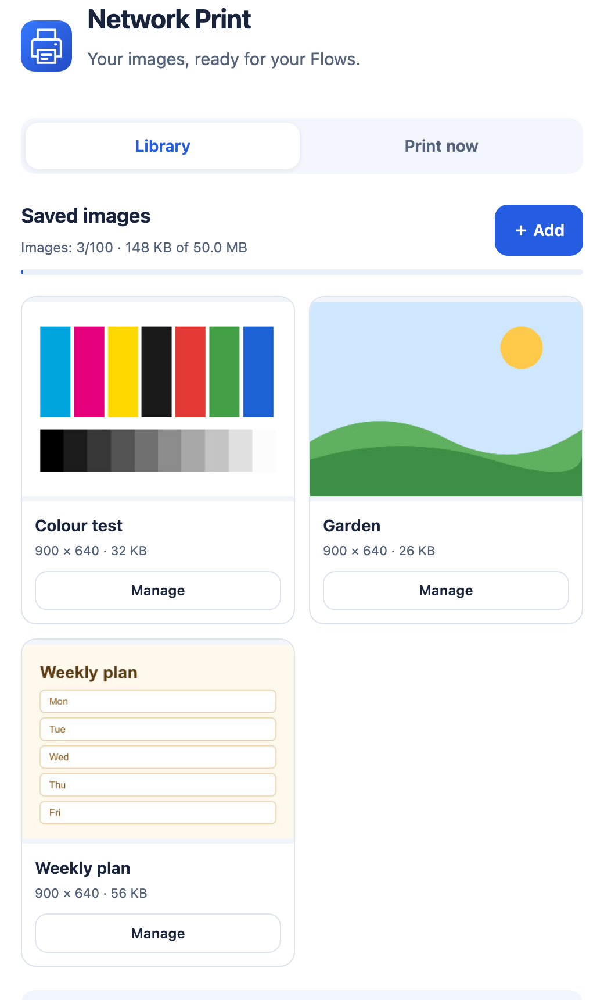

<p align="center"></p>

<h1 align="center">Network Print</h1>

<p align="center">A Homey Pro app that prints text and images on an IPP network printer, directly from Flows.<br>Built on the <a href="https://apps.developer.homey.app/">Homey Apps SDK 3</a>, with its own IPP client and pure-JavaScript rendering through <a href="https://github.com/joshmarinacci/node-pureimage">pureimage</a>.</p>

<p align="center"></p>

No NAS, CUPS server, computer or cloud service is needed: Homey talks to the printer itself over IPP or IPPS.

## Features

- **Direct printer pairing**: *Devices → + → Network Print → Network printer* searches the network (mDNS, `_ipp` and `_ipps`) or takes an address typed by hand. Pairing reads the printer's capabilities without printing. A printer that announces both IPP and IPPS appears once; queues shared by a NAS or another computer are listed separately under *Shared printers*.
- **Image library**: upload JPEG or PNG files in the app settings and print them from Flows with *Print an image from the library*. Images are kept on Homey through restarts and app updates. Renaming or replacing an image keeps every Flow that uses it working. Up to 100 images, 50 MB in total, 10 MB per file.
- **Library backup**: *Export backup* saves the whole library as one JSON file; *Import backup* restores it with the same Flow links.
- **Flow cards**:
  - *Print text*: text is laid out with Noto Sans, split into pages and printed as JPEG pages.
  - *Print an image from a URL*: HTTP or HTTPS, no credentials, up to three redirects.
  - *Print an image tag*: for example a camera snapshot.
  - *Print an image from the library*: pick an image by name.
  - *The printer is ready* (condition).
- **Print now**: a tab in the app settings to print a text, a JPEG/PNG file or an image URL without a Flow.
- **Per-printer settings**: paper size (A4, A3, A5, Letter, 10 × 15 cm), colour, image scaling (fit or fill) and text size (8–36 pt), checked against what the printer declares before each job.
- **Printer status**: a *Printer status* sensor (Ready, Printing, Check printer), refreshed every minute.
- **Ink levels**: one *Ink level* sensor per tank, named after the colour the printer reports (for example Matte black, Photo black, Cyan), with Insights history. Flow cards: *An ink is running low* (once per ink, at the low level the printer reports, usually 15%), *An ink level changed*, both with *Ink* and *Level (%)* tags, and the condition *Ink level is below…* for one ink or any ink.
- **13 languages**: English, Dutch, German, French, Italian, Swedish, Norwegian, Spanish, Danish, Russian, Polish, Korean and Arabic (right-to-left) for Flow cards, settings, the pairing screen and error messages. Homey picks the language it is set to.

## Requirements

- Homey Pro with firmware 12.1.0 or later (`compatibility` in [app.json](app.json)).
- A network printer that speaks IPP or IPPS and accepts `image/jpeg` (most AirPrint and IPP Everywhere printers do).
- To build and install: Node.js 22 or later and the Homey CLI, signed in to your account:

```bash
npm install -g homey
homey login
```

The only runtime dependency is `pureimage` (with `jpeg-js` and `pngjs`), used to lay out text and convert PNG to JPEG. It has no native modules, so the same package runs on every Homey Pro.

## Installation

```bash
git clone https://gitlab.com/giuliomaffei90/homey-network-print.git
cd homey-network-print
npm ci
npm test
homey select
homey app install
```

`npm test` runs the unit tests against a simulated IPP server and local files; it never contacts a printer. `homey select` picks the Homey to install on, and `homey app install` uploads the app, which keeps running after the terminal is closed. Don't pass `--clean` when updating, or the paired printers and the image library are removed.

For development, `homey app run` streams the app's logs, and `node scripts/preview.js` serves the settings page (`http://127.0.0.1:8768/?lang=en`) and the pairing page (`/pair`) with a temporary library and printing disabled.

To check a printer without printing:

```bash
npm run probe -- ipp://192.168.1.100/ipp/print --allow-self-signed
```

## How it works

1. **Pairing**: [drivers/printer/driver.js](drivers/printer/driver.js) merges the mDNS results of both protocols with [lib/discovery.js](lib/discovery.js). The pairing view [drivers/printer/pair/connect.html](drivers/printer/pair/connect.html) sends the chosen address to the `verify` handler, which runs `Get-Printer-Attributes` through [lib/ipp.js](lib/ipp.js) and refuses printers that do not list `image/jpeg`.
2. **Upload**: the settings page [settings/settings.js](settings/settings.js) sends the file in 192 KB chunks through the app API ([api.js](api.js)) together with a thumbnail it draws in the browser.
3. **Storage**: [lib/library.js](lib/library.js) converts the image to JPEG, encrypts it with AES-256-GCM (key kept in the app settings) and writes it atomically to `/userdata/print-library`, with a stable ID that Flows store.
4. **Flow run**: [app.js](app.js) resolves the library ID, the URL or the image tag to bytes and calls `printImage` on the device ([drivers/printer/device.js](drivers/printer/device.js)).
5. **Rendering**: [lib/render.js](lib/render.js) checks size and format, converts PNG to JPEG on a white background, and for text builds pages at 150 dpi with 12 mm margins.
6. **Ink levels**: on every refresh the device turns the IPP `marker-*` attributes into percentages with [lib/inks.js](lib/inks.js), adds an `ink_level.<name>` capability for each new tank and fires the Flow triggers. Which tanks are already low is kept in the device store, so *An ink is running low* does not repeat after a restart.
7. **Printing**: the device refreshes the printer's attributes, checks the chosen paper, colour and scaling against them, then sends one `Print-Job` per page. Only one job at a time is sent to each printer.
8. **Languages**: every string lives in [locales/](locales/). The pages use `Homey.__()`, and the backend uses [lib/i18n.js](lib/i18n.js) with the language Homey reports.

## Known limitations

- Only JPEG and PNG are accepted. PDF, SVG, HEIC and WebP are not. Photos from an iPhone are usually converted to JPEG by the browser when uploaded; if not, export them as JPEG first.
- PNG up to 8 megapixels, JPEG up to 50 megapixels. EXIF orientation is not applied: rotate the image before uploading.
- Text is printed with Noto Sans, which covers Latin, Greek and Cyrillic. Emoji and other scripts (Korean, Arabic, Chinese…) are not rendered on paper, even though the interface is translated. Text is limited to 30,000 characters and 10 pages.
- Printers that need TLS with a self-signed certificate (Epson, for example) need *Accept the self-signed certificate* at pairing. The exception applies only to that printer; image downloads over HTTPS always verify certificates.
- A sent page means the printer accepted the job, not that a sheet came out. Errors and timeouts after sending are reported and never retried automatically, to avoid duplicate prints; check the printer queue before trying again.
- If the printer's IP address changes, update it in the device settings. A DHCP reservation on the router avoids this.
- The library lives in the app's storage: uninstalling the app or resetting Homey deletes it. Export a backup first.
- Ink levels are what the printer reports. Refillable tank printers (Epson EcoTank and similar) estimate them from the ink used since the last refill confirmed on the printer, so they are wrong if a refill is not confirmed there.
- *Fill page* may crop the edges and does not enable borderless printing by itself.

## Credits

Noto Sans is distributed under the SIL Open Font License, included in [assets/fonts/OFL.txt](assets/fonts/OFL.txt). References: [Homey Apps SDK](https://apps.developer.homey.app/), [IPP](https://www.pwg.org/ipp/).
